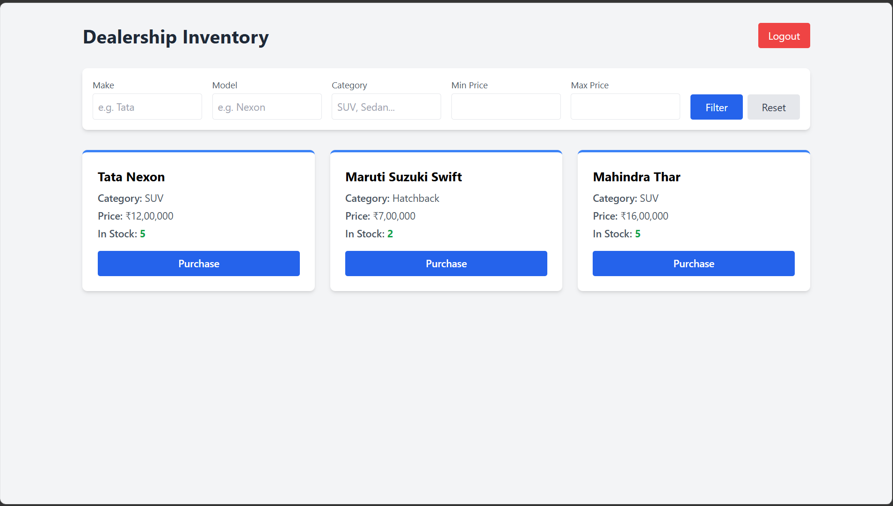
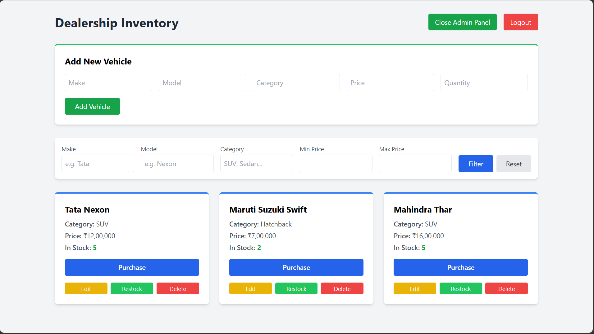

# Car Dealership Inventory System - TDD Kata

A full-stack, single-page application (SPA) built to manage a car dealership's inventory. This project was developed following a strict Test-Driven Development (Red-Green-Refactor) approach. It features role-based access control, allowing standard users to browse and purchase vehicles, while administrators can add, update, delete, and restock inventory.

## Tech Stack
* **Frontend:** React, Vite, Tailwind CSS, React Router, Axios
* **Backend:** Node.js, Express.js, JSON Web Tokens (JWT), bcryptjs
* **Database:** MongoDB Atlas (Mongoose)
* **Testing:** Jest, Supertest

## Features
* **JWT Authentication:** Secure user registration and login.
* **Role-Based Access Control:** Separate interfaces and permissions for standard users and admins.
* **Inventory Management:** Complete CRUD operations for vehicles (Admin only).
* **Live Search & Filter:** Query vehicles by make, model, category, and price range.
* **Transactional Actions:** "Purchase" functionality that safely decrements stock, preventing negative inventory.

## Local Setup Instructions

### Prerequisites
* Node.js installed on your machine
* A MongoDB Atlas cluster (or local MongoDB instance)

### 1. Clone the Repository
\`\`\`bash
git clone https://github.com/Zedstrider/car-dealership-inventory.git
cd car-dealership-inventory
\`\`\`

### 2. Backend Setup
\`\`\`bash
cd backend
npm install
\`\`\`
Create a `.env` file in the `backend` directory and add the following:
\`\`\`env
PORT=5000
MONGO_URI=your_mongodb_connection_string
JWT_SECRET=your_jwt_secret_key
\`\`\`
Start the backend server:
\`\`\`bash
npm run dev
\`\`\`

### 3. Frontend Setup
Open a new terminal window:
\`\`\`bash
cd frontend
npm install
npm run dev
\`\`\`
The application will be running at `http://localhost:5173`.

## Screenshots
### Search & Filter Dashboard

### Admin Inventory Management

## Testing
The backend API was developed using TDD. To run the test suite:
\`\`\`bash
cd backend
npm test
\`\`\`

---

## My AI Usage

**AI Tool Used:** Gemini

**How I Used It:**
* **Boilerplate & Infrastructure:** I used Gemini to rapidly scaffold the initial Express server, mongoose models, and the Vite/React frontend structure.
* **TDD Implementation:** I collaborated with the AI to establish a Red-Green-Refactor cycle using Jest and Supertest, ensuring tests were written and failing before implementing the controller logic.
* **Debugging:** Used the AI as a sounding board to debug a specific role-based authorization bug where the frontend Admin UI was blocked by a `req.user.userId` vs `req.user.id` mismatch in the JWT payload.
* **Styling:** Generated Tailwind CSS utility class combinations for responsive dashboard layouts and form styling.

**Reflection:**
Integrating AI into my development workflow acted like a highly responsive pair-programming session. It significantly accelerated the setup phase and allowed me to focus heavily on architectural decisions—such as separating the standard API routes from the protected admin middleware. It was particularly effective at isolating syntax bugs during debugging, though it required strict oversight to ensure the generated code aligned exactly with my testing constraints and MongoDB Atlas schema.

---
**Author:** Sharath P